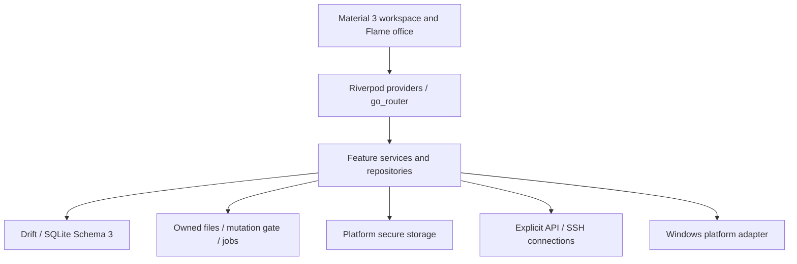

# Architecture

KADO Desk 2.4 is a local-first Flutter client. Cloud infrastructure is unconfigured; the public source does not require a server for local use.

`apps/client/lib/app` assembles state, routes and shell. `core` holds persistence, security, platform adapters, modules and shared UI. `features` contains the six original modules, utilities, developer tools and Studio runtime. `shared` provides common page/record controls.

The database migration implementation and generated Drift definitions are retained in `core/database`. Module hiding does not delete data. Stable Android and Windows storage/credential identities are deliberately distinct from the visible KADO brand.

Developer tools reuse existing data stores, jobs and IO guards. Bounded formatting/regex work runs in killable isolates. File operations avoid arbitrary script execution; task artifacts can require explicit review. API Studio is a user-invoked network capability, not a general agent network tool. Docker extensions reuse the existing SSH connector and pinned fingerprints.

Native code is included under Windows runner and Android/iOS platform projects. Desktop integrations are capability-dependent; source presence does not establish mobile equivalence. See [BUILDING.md](BUILDING.md) and [KNOWN_ISSUES.md](KNOWN_ISSUES.md).
