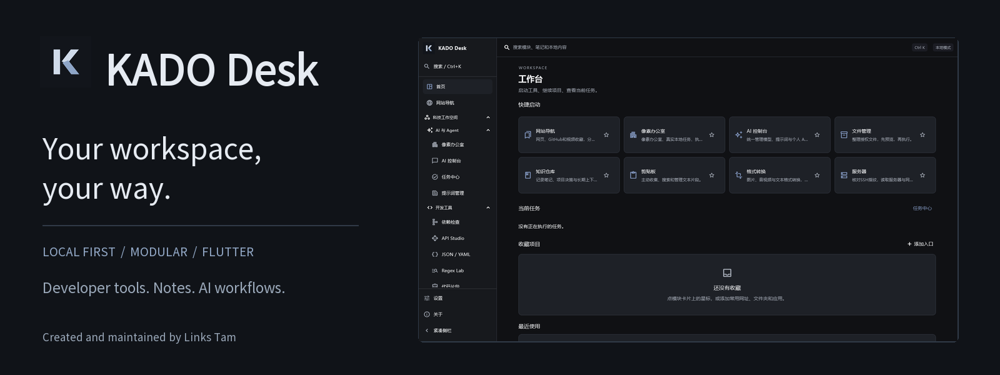
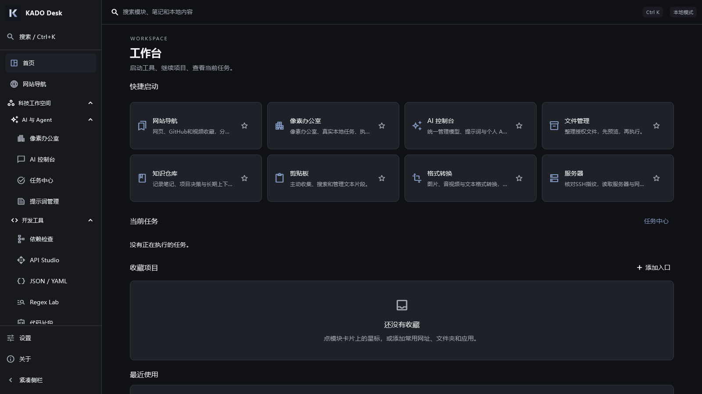
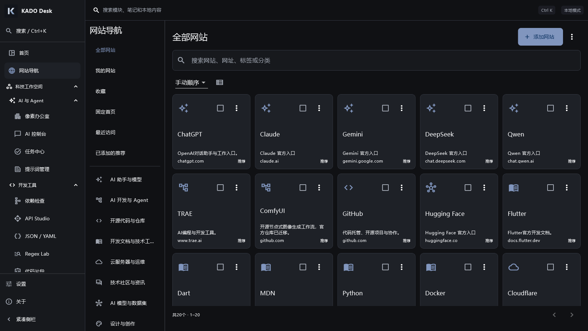
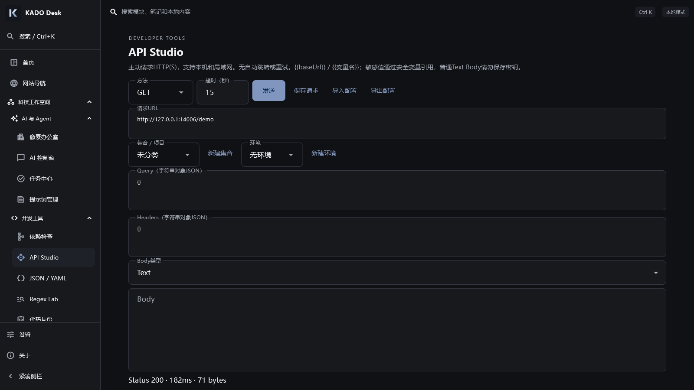
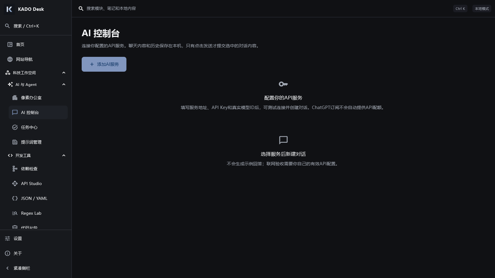
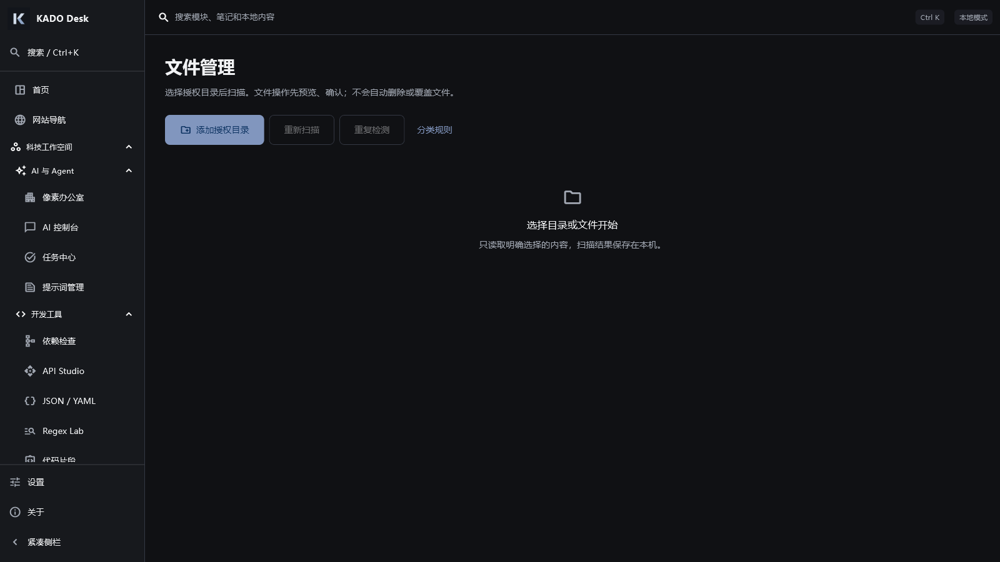
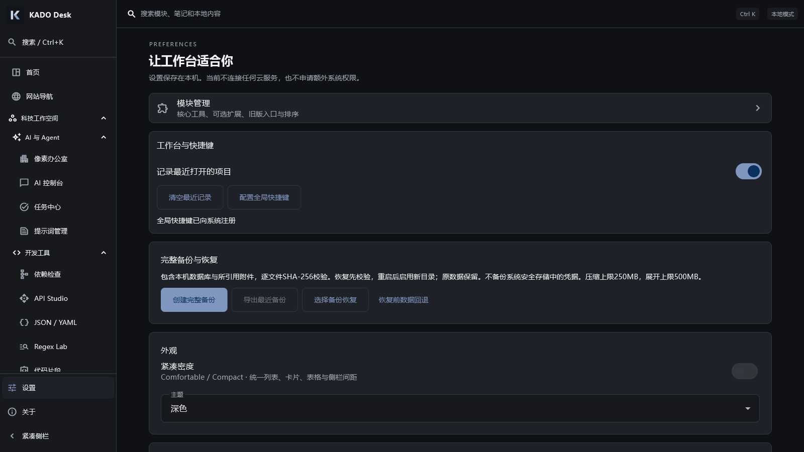
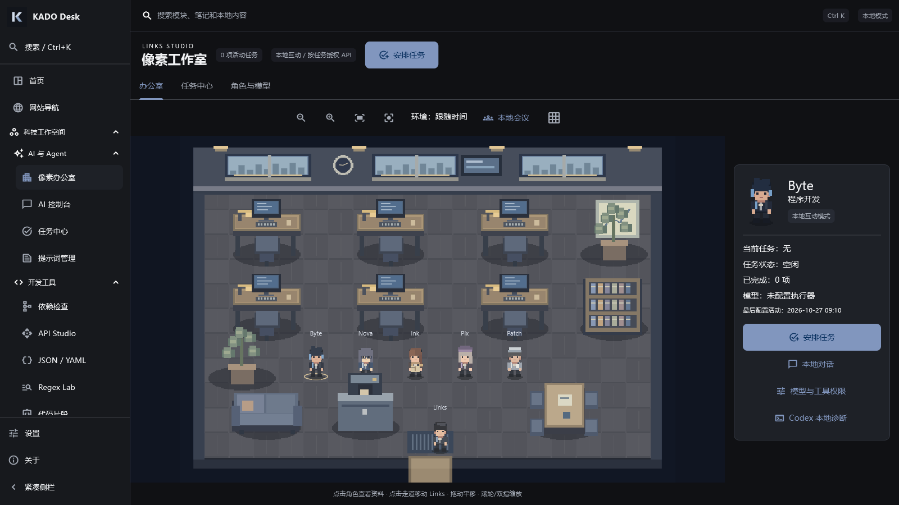
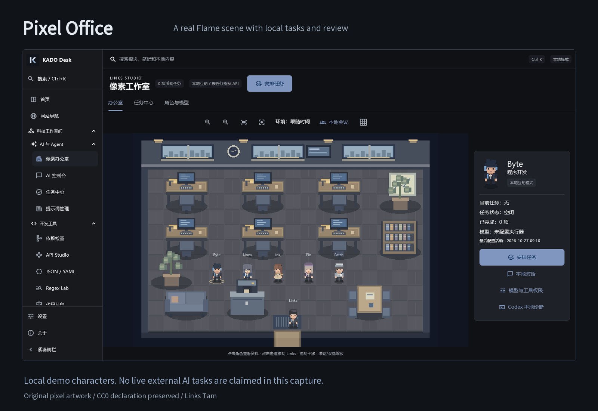

<p align="center"></p>

<p align="center"><strong>Your workspace, your way.</strong><br>A modular, local-first desktop workspace for people who build things.</p>

<p align="center"><a href="README.zh-CN.md">简体中文</a> · <a href="#download">Download</a> · <a href="BUILDING.md">Build</a> · <a href="docs/V24_TOOLS_GUIDE.md">Tools guide</a> · <a href="LICENSE">MIT license</a></p>

KADO Desk brings website bookmarks, developer utilities, files, notes, AI providers and a pixel office into one personal workspace. Configure the parts you use; your local records live in SQLite. External AI and SSH connections run only after you configure them. No cloud account is required for the local workspace.

**2.4.0+24 · Flutter / Dart · Windows tested · Android Release built · iOS unverified**

> **Looking for the app?** Open **Releases** on this repository's right sidebar and download a Windows installer/portable ZIP or Android APK. GitHub's **Source code** ZIP contains source, not a compiled application. [Installation help](docs/DOWNLOADS.md).



## Make room for the work you do

|Area|What is available now|
|---|---|
|Workspace|Two-level collapsible navigation, saved sidebar width/state, compact density, quick launch and real recent activity.|
|Developer Tools|API requests with collections/environments, JSON/YAML formatting and diff, bounded regex execution, streamed SHA256/512, snippets, network diagnostics and paginated logs.|
|AI & Agents|User-configured compatible API providers, streamed chat and usage records; local task execution, logs and explicit artifact review in Pixel Office. External model access requires your own provider.|
|File & Media|Preview-based file organization/undo, renaming, image and document tools. Audio/video conversion and transcription require separately installed FFmpeg/Whisper/model files.|
|Knowledge|Markdown notes, projects, attachments, search and context exports.|
|Web Library|Built-in public catalog plus your categories, favorites, imports and exports. Metadata requests are controlled; no embedded general-purpose browser claim.|
|System & Network|Pinned SSH host fingerprints, read-only server/Docker views, explicit single-target diagnostics, environment snapshots/diff and static dependency inspection.|

Low-frequency legacy tools can be shown in **Settings → Module manager**. Hiding a module does not delete its records. The local workflow tool combines supported file operations; it does not execute arbitrary scripts.

## A look inside

All images below are real Windows native Flutter captures from a verifiable development build, at 1600×900 with a fresh synthetic database. No private notes, API keys or server accounts were used. Original captures and provenance are available with the local release-preparation materials.

|Web Library|Developer Tools|
|---|---|
|||
|AI Desk — unconfigured|File Manager — no folder selected|
|||
|Settings|Pixel Office|
|||

## Pixel Office



Six original pixel characters share a Flame scene connected to local tasks, tool calls, logs and reviewable artifacts. The screenshot shows local demo characters, **not multiple external AI models working autonomously**. External AI tasks require a configured provider and supported tools. Original sprites, editable layers and the generation script are included; their CC0 declaration is preserved.

## Download

Use this repository's **Releases** page. The repository owner publishes those files manually; a download is available only once that Release has been published.

|File|Use|
|---|---|
|`KADO-Desk-v2.4.0-Windows-Setup.exe`|Per-user Windows x64 installation.|
|`KADO-Desk-v2.4.0-Windows-Portable.zip`|Extract the entire directory; run `links_toolbox.exe`. Keep DLLs and `data/`.|
|`KADO-Desk-v2.4.0-Android-arm64.apk`|Most current ARM64 Android devices; Release-signed, device testing pending.|
|`KADO-Desk-v2.4.0-Android-Universal.apk`|ARM32 / ARM64 / x86_64 coverage in one APK.|
|`SHA256SUMS.txt`|Checksums of the actual Release files.|

Windows builds are locally unsigned; SmartScreen may warn. Verify the source and checksum rather than disabling Windows protection globally. Android uses a maintainer development signing certificate; a differently signed build cannot replace an installed copy without migration. Back up your data before uninstalling. No IPA is provided.

Portable mode stores data in `user-data` beside the executable. Installed mode keeps the existing Links Toolbox storage identity for upgrades. Schema 3 and stable package IDs are preserved. [Backup and restore](docs/BACKUP_RESTORE.md).

## Why KADO?

This started with everyday personal needs: a place for useful links, small developer tasks, files and notes. Many excellent open-source tools already exist. KADO focuses on bringing the parts that fit this workflow into a manageable local environment, with clear boundaries around automation and external services.

## Under the hood

Flutter / Material 3 and Riverpod provide the interface and state; go_router handles navigation. Drift/SQLite stores records locally, and platform secure storage holds configured credentials. Flame runs the pixel scene. File mutations pass through shared preview/review and queue boundaries where applicable. Native Windows adapters supply supported OS integrations. [Architecture](ARCHITECTURE.md) · [Build instructions](BUILDING.md).

Quick start for developers, after installing the documented SDKs:

```powershell
cd apps/client
flutter pub get
flutter analyze
flutter run -d windows
```

Full tests create synthetic fixtures first; see `BUILDING.md`. You supply your own Android signing material and optional external engines. Maintainer credentials and caches are not included.

## Platform status

|Platform|Actual status|
|---|---|
|Windows x64|Release build and native business tests passed; installer/portable startup and data-preserving upgrade tests on the development PC.|
|Android|Release APK built and signature checked. Emulator/physical device behavior **UNVERIFIED**. Desktop-only integrations are not promised on Android.|
|iOS / iPadOS|Source project present. macOS/Xcode build, signing and device behavior **UNVERIFIED**; no IPA.|
|Linux / macOS desktop / Web|Not release targets of this package.|

OS physical-input hotkeys, Explorer pointer-drag, physical DPI changes, user remote Docker, true cold-cache timing and 30-minute memory still need separate validation. Core navigation and UI have bounded-size/layout coverage; that is not device certification. See [known issues](KNOWN_ISSUES.md) and [test report](docs/TESTING.md).

## Next

Device testing, accessibility refinements and feedback-driven polish come next. Remote/cloud sync remains unconfigured. There is no claim of a fully autonomous AI company or universal platform parity. [Roadmap](ROADMAP.md).

## Contributing and security

Bug reports with reproduction steps and small, reviewed improvements are welcome. Do not post API keys, personal databases or private logs. Read [CONTRIBUTING.md](CONTRIBUTING.md) and [SECURITY.md](SECURITY.md).

## License and credits

Project code and original KADO brand artwork are **MIT**, copyright © 2026 Links Tam, authorized by the owner for this public copy. Pixel assets retain their existing CC0 declaration; Noto Sans SC is SIL OFL-1.1. Dependencies and optional engines retain their own terms. [Third-party notices](THIRD_PARTY_NOTICES.md).

**Created and maintained by Links Tam.**
